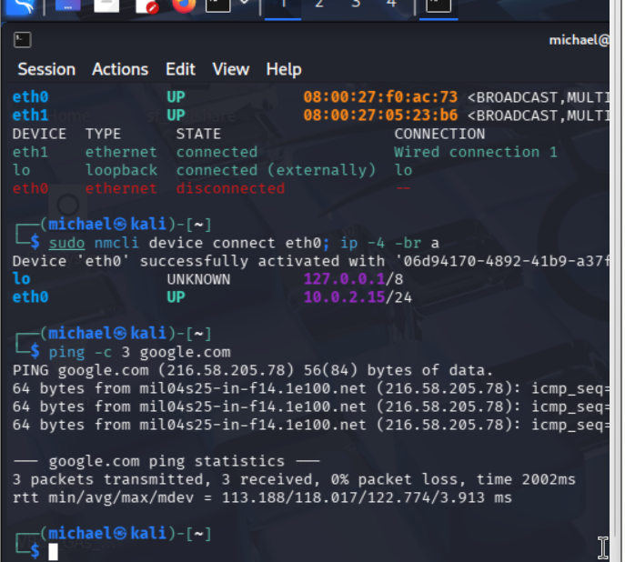
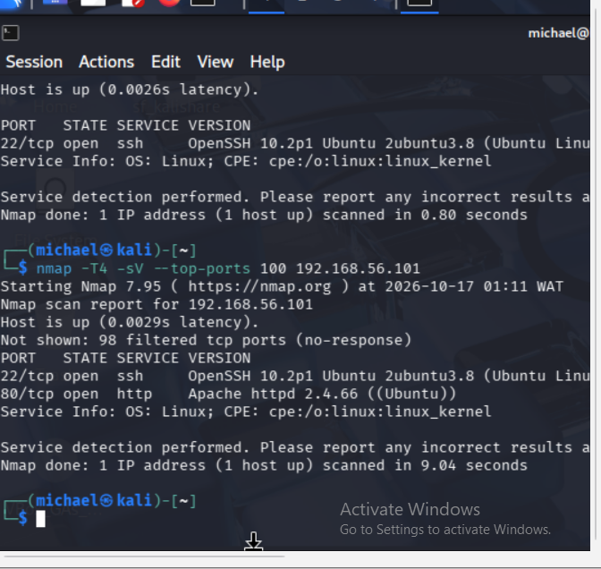
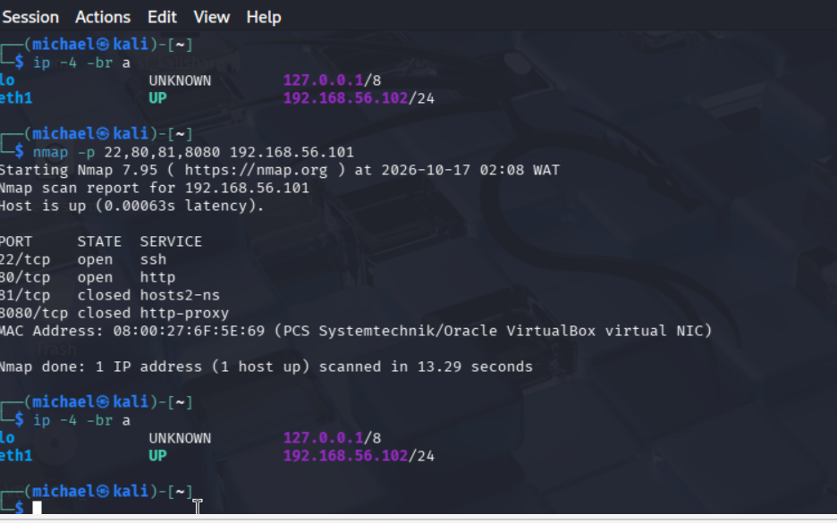
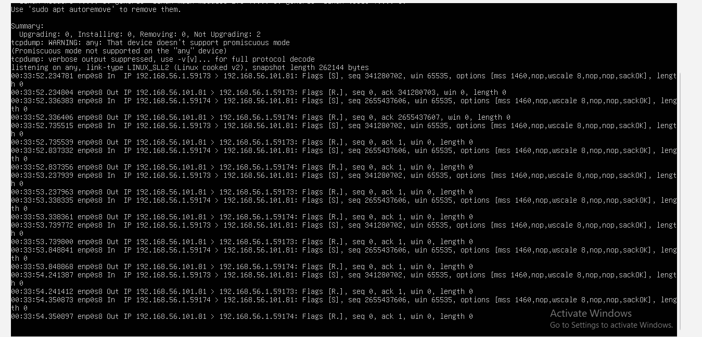
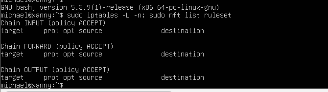
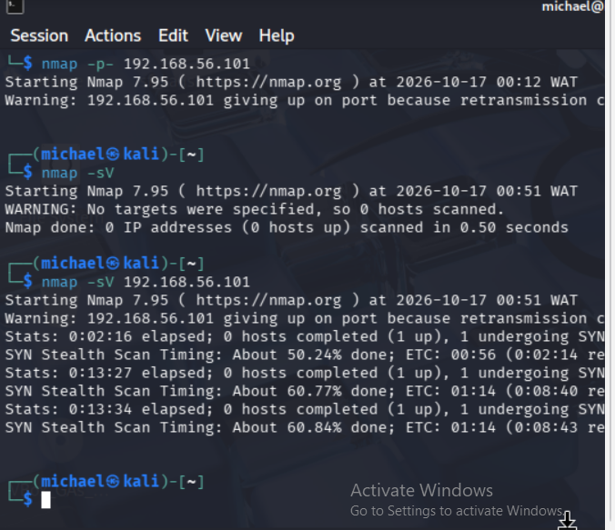

# Linux Security Lab (VirtualBox)

## Overview

A hands-on cybersecurity home lab built using Kali Linux and Ubuntu Server in Oracle VirtualBox. The project focuses on network reconnaissance, Linux service discovery, packet analysis, and foundational defensive security.

## Lab Architecture

## | Machine | Role | Operating System | Lab IP | Services |

| Kali | Security testing | Kali Linux | `192.168.56.102` | nmap, curl, other Kali tools|

| xanny | Target and defensive analysis | Ubuntu Server LTS | `192.168.56.101` | 	OpenSSH (22), Apache (80) |

**Host:** Windows PC with 8 GB RAM  
**Virtualization:** Oracle VirtualBox

### Network Design

Each virtual machine uses:

**Adapter 1 - NAT:** internet access for updates and package installs

**Adapter 2 - Host-only:** private lab network so the VMs can reach each other without being exposed to the wider network

## Tools Used

- Kali Linux
- Ubuntu Server LTS
- Oracle VirtualBox
- Nmap
- tcpdump
- Apache HTTP Server
- OpenSSH

## Setup Summary
Installed VirtualBox and created the Ubuntu Server VM from the LTS ISO (OpenSSH server enabled during install).
Imported the pre-built Kali VirtualBox image.
Added a Host-only adapter to both VMs and confirmed each received a 192.168.56.x address (ip -4 -br a).
Installed Apache on the target (sudo apt install apache2) to give the lab a second service to find.
Took snapshots of both VMs as a clean baseline to roll back to.

## Exercises Completed

### 1. Host and Service Discovery

Commands: From Kali

nmap -sV 192.168.56.101
nmap -T4 -sV --top-ports 100 192.168.56.101

**Result:** Identified SSH on TCP port 22 and Apache HTTP on TCP port 80, including service/version information where available.

### 2. Open, Closed, and Filtered Ports

Command:

nmap -p 22,80,81,8080 192.168.56.101

**Result:** Ports 22 and 80 were open; ports 81 and 8080 were closed after correcting the scan path.

### 3. Packet Capture on the Target

Command on Ubuntu:

sudo tcpdump -ni any port 81

**Result:** Observed incoming TCP SYN packets and TCP RST replies, consistent with closed-port behaviour.

### 4. Network Troubleshooting

**Problem:** Nmap reported ports 81 and 8080 as filtered, and full scans were extremely slow.

## Investigation:

Checked the target firewall: ufw inactive, iptables policies all ACCEPT, so the target was not dropping packets.
Ran tcpdump on the target and saw it was replying with resets (correct behaviour), but the packets were arriving from 192.168.56.1 (the Windows host), not from Kali.

**Cause:** Scans were not travelling directly over the Host-only network. Going through VirtualBox's NAT path, the replies were lost, so Nmap could not tell closed ports from filtered ones.

**Fix:** Confirmed Kali's Host-only interface (eth1, 192.168.56.102) was up and scanned the target directly. Ports 81 and 8080 then showed as closed and scans completed in seconds.

**Other fixes:** dhclient was not installed on Kali; used NetworkManager instead: sudo nmcli device connect eth0

## Skills Practised

- Linux system administration
- VirtualBox network configuration
- Network reconnaissance using Nmap
- TCP port-state interpretation
- Packet capture and analysis with tcpdump
- Basic service identification
- Technical troubleshooting and documentation

## Planned Improvements

- Complete a full TCP port scan.
- Analyse SSH authentication and Apache access logs.
- Configure UFW, Fail2ban, and Linux security auditing.
- Document a simulated security incident and remediation.
- Explore centralized monitoring and deliberately vulnerable lab applications.

## Ethics and Safety

All testing is performed only against virtual machines I own or am authorized to test. The lab uses a private Host-only network for security exercises.

## Screenshots

### 1. Lab Network Configuration

### 2. Nmap Service Discovery

### 3. Port-State Verification

### 4. Packet Capture Analysis

### 5. Firewall Investigation

### 6. Scan Performance and Troubleshooting

